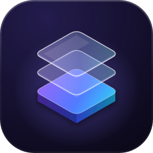

# Dodai UI

[](https://github.com/Dodai-Tech/dodai-ui/actions/workflows/security.yml)
[](https://github.com/Dodai-Tech/dodai-ui/actions/workflows/fuzz.yml)

A **design system**, not just a colour switcher, shipped as one crate per UI framework.
One token set (colour roles, typography, spacing, shape, glow and scanline effects, resolved
component styles) feeds the native adapters. Four designs ship in the box: Cyberpunk, Material 3,
Neo-Brutalism and Dodai.

| Crate | Framework | What you get |
|---|---|---|
| [`dodai-core`](crates/dodai-core) | none | `Theme`, `Palette`, tokens, `ThemeSwitcher`, WCAG contrast, ANSI-256 fallback, the four design systems (features) and `motion` (easing, springs, curves, stagger, entry effects, tweens) |
| [`dodai-gpui`](crates/dodai-gpui) | GPUI 0.2 | The design system in gpui: `Global` theme store, `cx.dodai()`, `DodaiStyled`, 160+ components |
| [`dodai-iced`](crates/dodai-iced) | Iced 0.14 | `IcedTheme` and a full component set: buttons, panels, tabs, inputs, lists, pickers, canvas chamfers, glow, frosted glass |
| [`dodai-bevy`](crates/dodai-bevy) | Bevy 0.20 | `bevy_ui` components, a chamfer material with hard shadow, glass and scanlines |
| [`dodai-dioxus`](crates/dodai-dioxus) | Dioxus 0.7 | Components and a theme provider, styled by `dodai-topcoat` |
| [`dodai-topcoat`](crates/dodai-topcoat) | Topcoat / any web | CSS custom properties and `.dodai-*` component classes, `clip-path` chamfers, one stylesheet per design |
| [`dodai-shaders`](crates/dodai-shaders) | wgpu | 196 pixel shaders written in Rust (rust-gpu to WGSL): painted and cel-shaded scenes, cyberpunk cityscapes, Material 3, Matrix, CRT/VHS monitors, sacred geometry, pixel-art scenes; they follow the theme palette. Views for gpui, iced, bevy and dioxus (features) |
| [`dodai-icons`](crates/dodai-icons) | none | One typed `IconId` and the icon packs (Cyberpunk, Material Symbols, Neo-Brutalism, symbol sets) |
| [`dodai-fx`](crates/dodai-fx) | none | Surface textures and effects, no dependencies (optional `frost` feature re-exports `dodai-frost`) |
| [`dodai-frost`](crates/dodai-frost) | none | Frosted glass on RGBA pixels, GPU first with a CPU fallback |

Also in the repository but **not part of the first release**: `dodai-charts` (70 gpui charts and their
renderer-agnostic maths), `dodai-dash` (a dashboard engine: a TOML and JSON dashboard format, validation against your own metrics, view models; no storage and no rendering; see its [README](crates/dodai-dash/README.md)), `dodai-ratatui` (a terminal adapter, still small) and the egui,
slint, yew, leptos and freya adapters.

**Started:** [`dodai-xilem`](crates/dodai-xilem) for [xilem](https://github.com/linebender/xilem) (masonry widgets, vello renderer). Scaffold only: colour conversion and a themed button.

## Status (0.1)

The gpui, iced, bevy, dioxus and topcoat (server-rendered HTML) showcases show the same pages, built from one shared model
(`dodai-showcase-model`). They are checked by screenshots; mouse and keyboard interaction has
not been tested on every control in every toolkit yet, so expect rough edges in popovers, sliders
and drag handling. Minimum Rust versions differ per crate (see each
crate's `rust-version`).

## Themes

**Cyberpunk** (a cyberpunk-inspired theme):

| Token | Value |
|---|---|
| Signature yellow | `#fcee0a` (hover `#f2e900`) |
| Cyan | `#00f0ff` |
| Red | `#fe1038` |
| Orange | `#ff6000` |
| Surfaces / lines | `#000` · `#333` · `#4c4c4c` · text `#fff` / `#cbcbcb` |
| Type | Blender Pro → Rajdhani fallback, UPPERCASE labels, tracked |
| Shape | 0 radius, 2 px borders, 48 px controls, 16 px chamfer (cut top-left + bottom-right) |
| Effects | yellow glow on hover/focus, optional CRT scanlines |

Glow is configurable: `theme.with_glow_intensity(1.5)` (0 = off, 1 = as designed) scales glow alpha and radius in every adapter.

Variants: `cyberpunk` (yellow), `cyberpunk-cyan` (cyan), `cyberpunk-red` (red), each also as a light theme on warm paper: `cyberpunk-light`, `cyberpunk-cyan-light`, `cyberpunk-red-light` (same chamfered shape, deeper neons for contrast, glow dialled down).

**Neo-Brutalism** (`neobrutalism[-accent][-dark]`, 14 themes): 2 px outlines, 4 px hard shadows, flat colour blocks, buttons that sink into their shadow on hover.

**Material 3** (a Material-3-inspired light/dark pair): `material`, `material-dark` — rounded, mixed-case, flat tonal surfaces, no glow.
Every theme is contrast-tested (text ≥ 7:1, primary label ≥ 4.5:1).

## Use it

```toml
[dependencies]
dodai-core    = { version = "0.1", features = ["cyberpunk", "material"] }
dodai-iced    = "0.1"   # or dodai-gpui / dodai-bevy / dodai-dioxus / dodai-topcoat
```

```rust
let mut sw = dodai_core::switcher();      // all built-in themes
let theme = sw.current().clone();         // hand it to your toolkit's adapter
let next = sw.cycle_next().clone();       // switch at runtime: shape, type and glow change too
```

Persist `theme.id()` (e.g. `"cyberpunk-cyan"`) in your config and restore with `switcher.select(id)`.

## Surface effects

One type, `dodai_core::Surface`, sets every surface effect (frosted glass, textures, gloss, glitch,
neon, ripple, ...), app-wide with `set_surface` or per component with `.surface(..)`. Unset follows
the design: No design is frosted out of the box; Dodai suggests it (`Surface::frosted()`). A design draws only the effects
it owns, so `glitch(0.6)` shows on Cyberpunk and nothing on Material 3.

```rust
use dodai_core::Surface;
set_surface(cx, Surface::frosted());                                  // every container and field
Button::new("Save").surface(Surface::new().glitch(0.6));               // one component
```

`SurfaceMode` (Off, Design, Frosted, Signature, Custom) names the ready-made looks; every showcase
has the same picker. Frost per toolkit:

| Toolkit | Frost |
|---|---|
| gpui, iced, bevy | blurred backdrop (`dodai-frost`; GPU first, CPU fallback) |
| topcoat, dioxus, yew, leptos | CSS `backdrop-filter` |
| egui, freya | painted by the adapter (freya uses `backdrop_blur`) |
| slint, ratatui | none |

## Pick only what you need

`dodai-core` carries the engine and the four design systems behind Cargo features
(`cyberpunk`, `material`, `neobrutalism`, `dodai`; all off by default). Icons and
shaders are their own crates.

| Crate | What it is |
|---|---|
| [`dodai-core`](crates/dodai-core) | Tokens, `Theme`, `ThemeSwitcher`, `ThemeBuilder`, DTCG export. Designs by feature: 6 Cyberpunk themes, the Material 3 pair, Neo-Brutalism (seven accents, light and dark) and Dodai (frosted glass) |
| [`dodai-icons`](crates/dodai-icons) | Every icon in one crate, packs chosen by feature: the typed `IconId`, the Cyberpunk pack (378 hand-drawn, curve-free icons), the full Material Symbols catalogue (3,900+ icons, outlined/rounded/sharp + fill) and Phosphor-derived sets |
| [`dodai-fx`](crates/dodai-fx) | Surface textures and effects. No dependencies by default; `frost` and `frost-gpu` re-export `dodai-frost` |
| [`dodai-frost`](crates/dodai-frost) | Frosted glass on RGBA pixels: GPU first (`gpu`, wgpu), CPU fallback, byte-identical |
| [`dodai-shaders`](crates/dodai-shaders) | Pixel shaders |

```toml
dodai-core  = { version = "0.1", features = ["material"] }    # the engine + Material 3
dodai-icons = { version = "0.1", default-features = false, features = ["material"] }
```

All crates share one version, bumped together by `nu scripts/bump_version.nu <version>`.

`dodai-core` is infrastructure: tokens, the shape-system engine, the `DesignSpec` trait and a generic baseline for component
tokens. A design module owns everything specific to it: palettes, shape language and presets, and a `DesignSpec`
(component tokens, row heights, focus ring, tooltip colours, …) attached with `Theme::with_spec`. Every hook is optional, so a
new design system overrides only what differs. `dodai_core::material` is the reference (`Material3`, `shape_system()`);
Cyberpunk has its own `DesignSpec` (glow, accent bar, outline-to-solid hover, solid active tab) and its shape presets in `dodai_core::cyberpunk::shape`; core's baseline is a plain, neutral design for custom themes.

## Material 3 conformance

The Material themes follow the M3 component specs: shape per component (`ShapeRole`: pill buttons,
16 px FAB, 12 px cards, 28 px dialogs, 4 px menus and fields, 8 px chips, ...), tonal containers
(`surface-container-*`), 8 % hover / 10 % press state layers, elevation as soft two-layer shadows,
and the 80 px navigation bar, rail and drawer with pill indicators. `crates/dodai-core/tests/material_spec.rs`
pins these numbers against the spec; other design systems keep their own geometry (also tested).
Material-only components: `ButtonGroup`, `SplitButton`, `LoadingIndicator`.
Also: 56 px list rows and 48 px menu rows, plain / rich tooltips, docked and full-screen
`SearchView`, carousel layouts (multi-browse, hero, centre hero), floating-label and filled
`TextInput`, `CheckboxVariant`, and keyboard focus: every tracked control is a Tab stop
(Enter / Space click it) and shows the theme's focus ring (`Theme::focus_ring`, 3 px `secondary`
on Material) while keyboard-focused.

## Motion (gpui)

Entry effects, value-in (grow) for charts/sliders/gauges, `CountUp`, eased toggle/tab/accordion
transitions, hover/press blend and a shape-adaptive `Shimmer`, all driven by `Motion`/`EntrySet`.
Try them per section in `just run-gpui`.

## Importable tokens and icons

`just export` (or `cargo run -p dodai-topcoat --example export -- dist`) regenerates `dist/`, which is
committed and checked in CI:

| File | For |
|---|---|
| `dist/tokens/dodai.tokens.json`, `dist/tokens/<theme>.tokens.json` | W3C Design Tokens (DTCG): Style Dictionary v4, Tokens Studio / Figma Variables, Penpot |
| `dist/css/dodai.css` | CSS custom properties (`--dodai-*`, `:root[data-theme=…]`) plus component CSS |
| `dist/css/dodai-cyberpunk.css`, `dist/css/dodai-material.css`, `dist/tokens/dodai-cyberpunk.tokens.json`, `dist/tokens/dodai-material.tokens.json` | The same, for one design system only: ship just Cyberpunk or just Material 3 |
| `dist/icons/svg/*.svg`, `dist/icons/dodai-cyberpunk-icons.svg` | The icon pack as SVG (`currentColor`), one file each and as a `<symbol>` sprite |

The pack (`dodai_icons::cyberpunk`, feature `cyberpunk`) has 378 icons in 7 groups, all straight lines, 45° chamfers and octagons.

## gpui features

`dodai-gpui` features (all default, all additive): `components`, `frost`, `cyberpunk`
(the stroked icon pack), `material` (the Material Symbols icons).
Components never look at a theme id: soft, tonal Material rendering is chosen by the theme's
`ShapeKind::Rounded`, and every colour comes from the palette or its M3-style `roles`
(`surface-container-*`, `outline`, `inverse-surface`, ...), which every theme has.

## Motion

`dodai_core::motion` is dependency-free and toolkit-independent: you pass it the clock (seconds) and apply
what it returns.

- **Easing / curves / tweens**: `Easing` (cubic-bezier, spring, bounce, elastic, back), `Curve`, `Tween`, stagger.
- **Physics** (closed form, any frame rate): `Spring` / `SpringState` (retarget keeps velocity), `Decay` (fling),
  `Bounce`, `rubber_band`, `damp`, `Shake`.
- **Composition**: `Clip<T>` with `then`, `zip`, `delay`, `repeat`, `forever`, `ping_pong`, `reverse`, `speed`, `map`, `stagger`.
- **Mixins**: reactive (`Reactions`: press squash, hover lift, focus glow, select pop), one-shot (shake, nudge,
  attention bounce, flash, pop in, count up, check draw), loading (shimmer, indeterminate, typewriter, marquee),
  gestures (swipe release, page snap, overscroll, pull to refresh, magnetic, tilt). They return a `Pose`
  (opacity, offset, scale, rotation, glow); an adapter applies one layered pose per widget.
- **Per design system**: each `Theme` carries a `Motion` (duration, easing, `Personality`), and
  `dodai_core::cyberpunk::fx` (glitch, flicker, decrypt, hologram, scan sweep, chamfer wipe) and
  `dodai_core::material::fx` (state layers, ripple, container transform, fade through, shared axis) add the
  system-specific ones. `.reduced()` degrades any pose to fades.
- **Web / slint**: no Rust needed; the exporter writes `--dodai-motion-duration|delay|easing` and a DTCG `motion` group.

In gpui, `dodai_gpui::motion::react` / `hover_lift` drive the mixins from interaction state; `Button`,
`IconButton` and `Fab` use it. See *Animation → Dynamics* in the showcase.

Instrument-style pieces: `Gauge` with `GaugeStyle` (arc, segmented, dial, meter, reticle, bar, chevron, level)
and `Oscilloscope`, `Spectrum`, `RadarScope`, `HexMap`, `RingStack`, `DotMatrix`, `SignalBars`.

## Shaders

`dodai-shaders` is a dependency-free set of per-pixel shaders written as plain Rust functions
(generators like `neon_grid`, `glow_waves`, `digital_rain`, `platformer`, post effects like `crt`, `vhs`,
`gameboy`), drawn from the active theme's palette. In gpui: `dodai_shaders::gpui::ShaderView::new("id", "neon_grid").fx("crt")`
(feature `gpui` of `dodai-shaders`). Demo of everything: the *Shaders* category of the showcase (`just run-gpui`); `just dump-shaders` renders image files.

## Adding a theme

1. Copy `crates/dodai-core/src/material` to `crates/dodai-core/src/<name>` (and add a feature): themes via `dodai_core::themes::ThemeBuilder`, a `DesignSpec` for the component tokens that differ (each hook is optional; set `Look` flags for tonal surfaces, soft elevation, floating labels, symbol icons), optionally a shape system and an icon crate. Attach the spec with `Theme::with_spec`.
2. Register it in one place: a feature plus an entry in `dodai_core::themes::systems()`. The switcher, `themes::all()`, `by_id()` and the `dist` export pick it up; adapters need no change.
3. `just test`: the shared contrast/uniqueness tests in `crates/dodai-core/tests` run on it. Add the design's own conformance tests next to its spec.

## Development

```sh
just check-all     # fmt + clippy -D warnings + cargo tests + nushell tests
just bump 0.2.0    # gate → bump versions → git-cliff changelog → commit + tag
just release 0.2.0 # bump + push; CI publishes to crates.io in dependency order
just push-all      # push to GitHub + Gitea remotes (`just setup-remotes` adds them)
```

Layout mirrors [gitkraft](../gitkraft) / [tokenburn](../tokenburn): `justfile`, `cliff.toml`
(conventional commits → changelog), `deny.toml`, Nushell scripts in `scripts/` with tests in
`scripts/tests/`, GitHub workflows `ci.yml` · `release.yml` · `security.yml`.

> GPUI needs the Xcode Metal toolchain on macOS; Linux needs the libs listed in `ci.yml`.

## License

MIT
